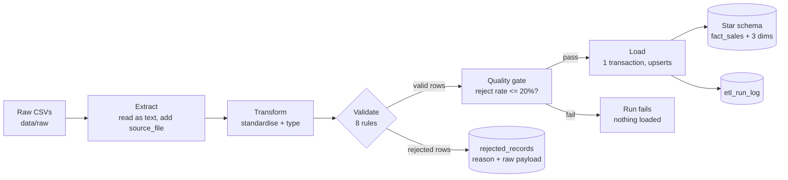

# Retail Batch ETL Pipeline

An automated batch ETL pipeline that ingests raw retail order CSVs, cleans and validates them with Pandas, and loads a **PostgreSQL star schema**, orchestrated by **Apache Airflow** and run with **Docker Compose**.

**Stack:** Python · Pandas · PostgreSQL · Apache Airflow · SQLAlchemy · Docker · pytest

## Architecture



Airflow DAG (`retail_etl`, daily): `extract >> transform >> validate >> load >> cleanup`. Tasks pass data to each other as parquet files in a per-run staging folder, not through XCom.

## Data model (star schema)

| Table | Grain | Notes |
|---|---|---|
| `fact_sales` | one order line | `UNIQUE (order_id, order_line)`, measures: quantity, unit_price, discount, gross_amount, net_amount |
| `dim_customer` | one customer | surrogate key + business key `customer_id`, SCD type 1 (latest attributes win) |
| `dim_product` | one product | surrogate key + business key `product_id` |
| `dim_date` | one calendar day | `date_key = yyyymmdd`, year/quarter/month/weekday/is_weekend |
| `rejected_records` | one rejected row per run | reason code + original raw row as JSONB |
| `etl_run_log` | one pipeline run | status, row counts, error message |

## Data quality rules

Every row is tagged with the **first** rule it breaks. Rejected rows are never silently dropped: they are stored in `rejected_records` with the reason and original values.

| Rule | Meaning |
|---|---|
| `missing_order_id` / `missing_customer_id` / `missing_product_id` | a key is null |
| `invalid_order_date` / `future_order_date` | unparseable date / date after today |
| `invalid_quantity` | null, zero or negative |
| `invalid_unit_price` | null, zero or negative |
| `invalid_discount` | outside 0..1 |
| `duplicate_order_line` | same `(order_id, order_line)` seen before (first one wins) |

Fixable problems are repaired, not rejected: whitespace/case in text, malformed e-mail (value nulled), missing country (`Unknown`).

**Quality gate:** if more than `MAX_REJECT_RATE` (default 20%) of rows are rejected, the run fails *before loading* and is logged as failed.

## Design decisions

- **Idempotent loads.** Dimensions upsert on their business key; the fact table upserts on `(order_id, order_line)`. Re-running the same data adds 0 rows, so Airflow retries and manual re-runs are safe.
- **Atomic load.** All upserts, the reconciliation check and the rejected-records insert happen in one transaction. Any failure rolls everything back (covered by a test).
- **Reconciliation.** Before commit, the pipeline re-queries the warehouse for the batch's rows and checks the row count and `SUM(net_amount)` match what it meant to load.
- **Auditability.** Every run is in `etl_run_log`; every reject is in `rejected_records`.
- **No retry on bad data.** The validate task raises `AirflowFailException` on a quality-gate failure, because retrying cannot fix bad data. Other failures retry twice.

## Run it

### Option A: full stack with Airflow (Docker)

```bash
cp .env.example .env
make up            # warehouse Postgres + Airflow   (UI: http://localhost:8080, admin / admin)
make data          # generates ~100k rows of dirty sample data into data/raw/
make trigger       # or press play on the retail_etl DAG in the UI
make psql < sql/analytics.sql     # run the analytics queries
make test          # run the test-suite in the container
```

The warehouse is exposed on `localhost:5433` (user/password/db: `warehouse` / `warehouse` / `retail_dw`).

### Option B: plain Python, no Airflow

```bash
docker compose up -d warehouse-db      # only the database
make local-setup local-data local-run  # venv, generate data, run the pipeline
make local-test
```

Any new CSV with the same columns dropped into `data/raw/` is picked up on the next run.

## Sample results

On the generated sample data (**synthetic**, 102,000 raw rows with injected problems):

| | |
|---|---|
| Rows extracted | 102,000 |
| Rows loaded to `fact_sales` | 95,096 |
| Rows rejected | 6,904 (6.8%) |
| Re-run of same data | 0 new fact rows (idempotent) |
| Pipeline run time | about 15 s on the test machine (most of it the load) |
| Tests | 27 passing (unit tests + Postgres integration tests) |

Rejections by reason: duplicate_order_line 1,902 · invalid_quantity 1,438 · missing_customer_id 1,021 · invalid_order_date 1,007 · invalid_unit_price 545 · future_order_date 498 · invalid_discount 493.

`sql/analytics.sql` has 9 queries on the warehouse: month-over-month growth (`LAG`), top-N per category (`RANK`), running totals (`SUM OVER`), revenue share, 7-day moving average (window frame), and data-quality checks.

## Project layout

```
dags/retail_etl_dag.py     Airflow DAG
etl/                       extract.py, transform.py, validate.py, load.py, pipeline.py,
                           run_pipeline.py (CLI), generate_data.py, config.py
sql/schema.sql             star schema + audit tables
sql/analytics.sql          analytics + data-quality queries
tests/                     pytest: transform, validate, load (integration)
docker-compose.yml         warehouse Postgres + Airflow
```

## Possible extensions

Incremental loads with a high-water mark, SCD type 2 for `dim_customer`, dbt models on top of the warehouse, PySpark for larger volumes, partitioning `fact_sales` by month, and Great Expectations for declarative data-quality checks.
